
<a href="https://github.com/nexteco/homepage">← 홈페이지로</a>

  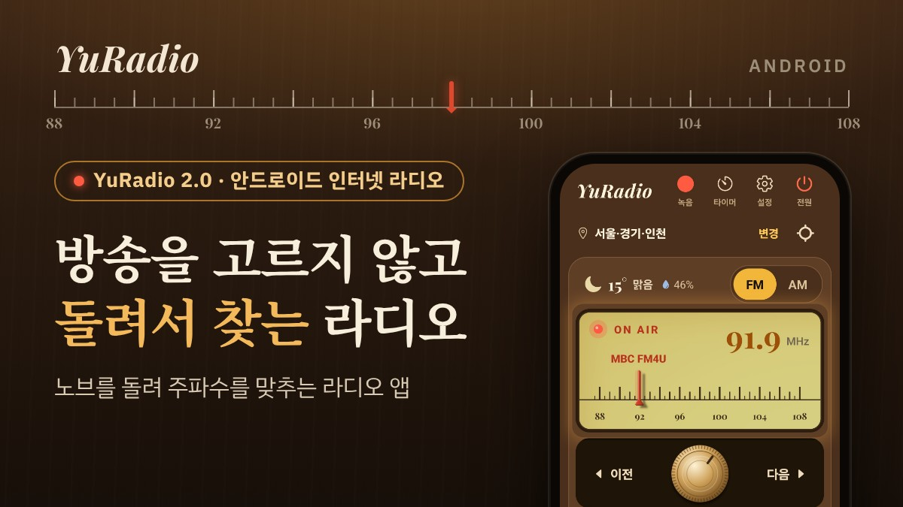

<h1 align="center">YuRadio</h1>

  <b>노브를 돌려 방송을 찾는 안드로이드 라디오 앱</b> 
  안드로이드 · 무료 · 회원 가입 없음 · 앱 안 광고 없음 · 정식 출시 전

  <a href="https://nexteco.github.io/homepage/yuradio/demo/"><b>▶ 웹에서 바로 만져 보기</b></a> (소리 없는 화면 시뮬레이션)

  <a href="#소개">소개</a> ·
  <a href="#github에서-바로-실행할-수-있나요">GitHub에서 실행할 수 있나요?</a> ·
  <a href="#설치-방법">설치 방법</a> ·
  <a href="#데이터와-권한">데이터와 권한</a> ·
  <a href="#아직-안-되는-것">아직 안 되는 것</a> ·
  <a href="#만든-이야기">만든 이야기</a>

---

## 소개

YuRadio는 운전하다가 라디오가 끊겨서 직접 만들기 시작한 안드로이드 앱입니다. 처음 버전은 끊기지 않고 나오게 하는 데 집중했습니다. 그런데 쓰다 보니 아쉬운 점이 하나 남았습니다. 방송 이름이 죽 적힌 목록에서 하나를 고르는 방식은 편하긴 한데, 찾는 재미가 없었습니다.

그래서 2.0에서는 화면을 통째로 바꿨습니다. 다이얼은 방송 이름을 미리 보여 주지 않습니다. 옛 라디오처럼 노브를 돌려 주파수를 맞추고, 바늘이 방송에 닿아야 이름이 뜨면서 소리가 나옵니다.

  <a href="https://nexteco.github.io/homepage/yuradio/demo/">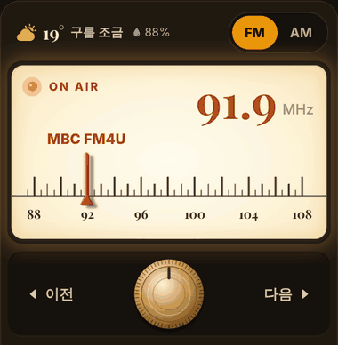</a> 
  웹 시뮬레이션에서 찍은 모습 — 그림을 누르면 직접 돌려 볼 수 있습니다

### 한눈에 보기

| 항목 | 내용 |
|---|---|
| **이름** | YuRadio 2.0 |
| **기기** | 안드로이드 휴대폰 (아이폰용은 없습니다) |
| **필요한 것** | 인터넷 연결 (Wi-Fi 또는 모바일 데이터) |
| **가격** | 무료. 회원 가입 없음. 앱 안에 광고 없음 |
| **듣는 것** | 서울·경기·인천의 FM 27개, AM 5개 · 해외 7개 나라 27개 도시의 다이얼 · 나라별 인터넷 방송 |
| **언어** | 한국어, 영어 |
| **지금 상태** | 정식 출시 전 — [설치 방법](#설치-방법)의 단계를 거치면 먼저 써 볼 수 있습니다 |

### 화면으로 보기

모두 실제 휴대폰(갤럭시 S22 울트라)에서 찍은 화면입니다.

<table>
  <tr>
    <td width="50%" valign="top">
      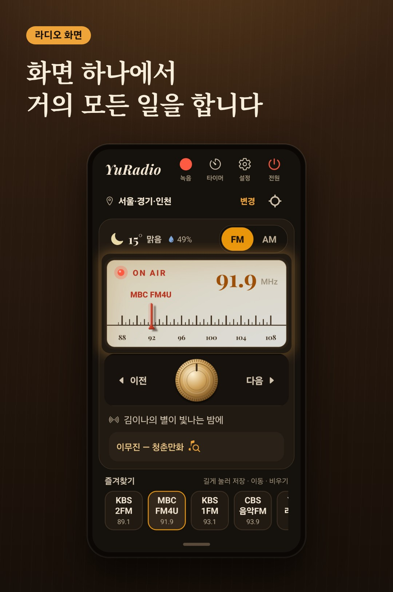
      위에서부터 녹음 · 타이머 · 설정 · 전원 버튼, 지역 줄, 날씨, 방송창, 튜닝 노브, 프로그램과 곡, 즐겨찾기입니다. 재생 · 일시정지 버튼은 따로 없고 <b>전원</b> 하나로 켜고 끕니다. 화면을 꺼도 방송은 이어지고, 알림과 잠금화면에서 멈추고 다시 틀 수 있습니다.
    </td>
    <td width="50%" valign="top">
      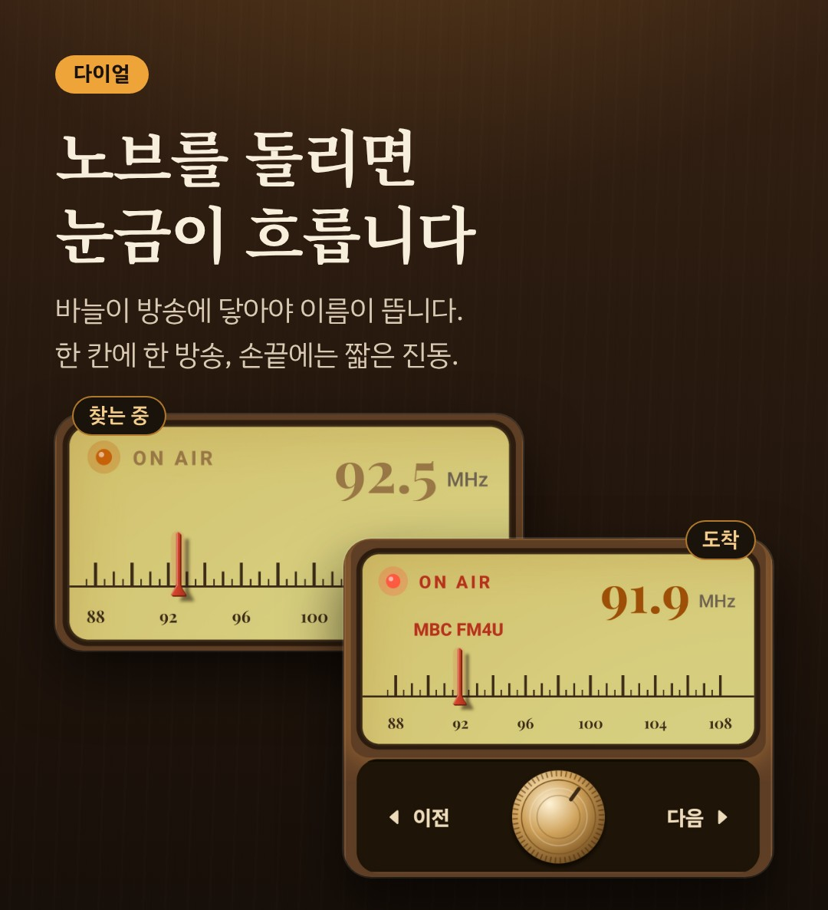
      노브를 한 칸 돌릴 때마다 짧은 진동과 함께 한 방송씩 넘어갑니다. 빨리 돌리면 여러 방송을 지나갑니다. 찾는 동안에는 눈금이 흐르고 ON AIR 표시등이 주황, 방송에 닿으면 빨강으로 켜집니다. 노브 양옆의 이전 · 다음을 눌러도 됩니다.
    </td>
  </tr>
  <tr>
    <td width="50%" valign="top">
      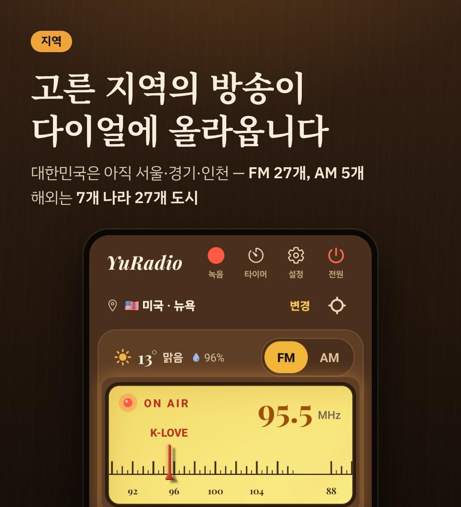
      진짜 라디오처럼 고른 지역의 방송이 다이얼에 올라옵니다. 지역 줄의 <b>변경</b>에서 고르거나, 내 위치 아이콘으로 지금 있는 곳에 맞춥니다. 나라는 22곳 가운데서 고르고, 다이얼이 있는 곳은 <a href="#다이얼이-있는-지역">아래 표</a>와 같습니다.
    </td>
    <td width="50%" valign="top">
      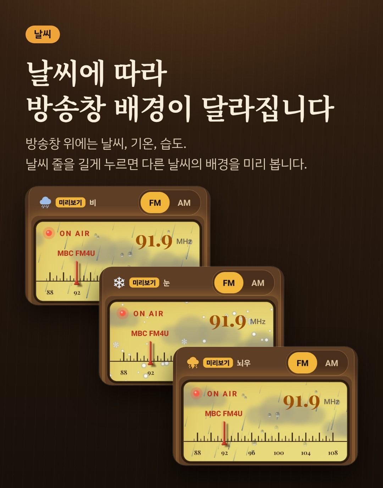
      방송창 위에 날씨, 기온, 습도가 보이고, 날씨에 따라 방송창 배경(비, 눈, 뇌우 등)이 달라집니다. 뉴욕 다이얼로 바꾸면 날씨도 뉴욕 날씨가 됩니다. 날씨 줄을 길게 누르면 다른 날씨의 배경을 미리 봅니다.
    </td>
  </tr>
  <tr>
    <td width="50%" valign="top">
      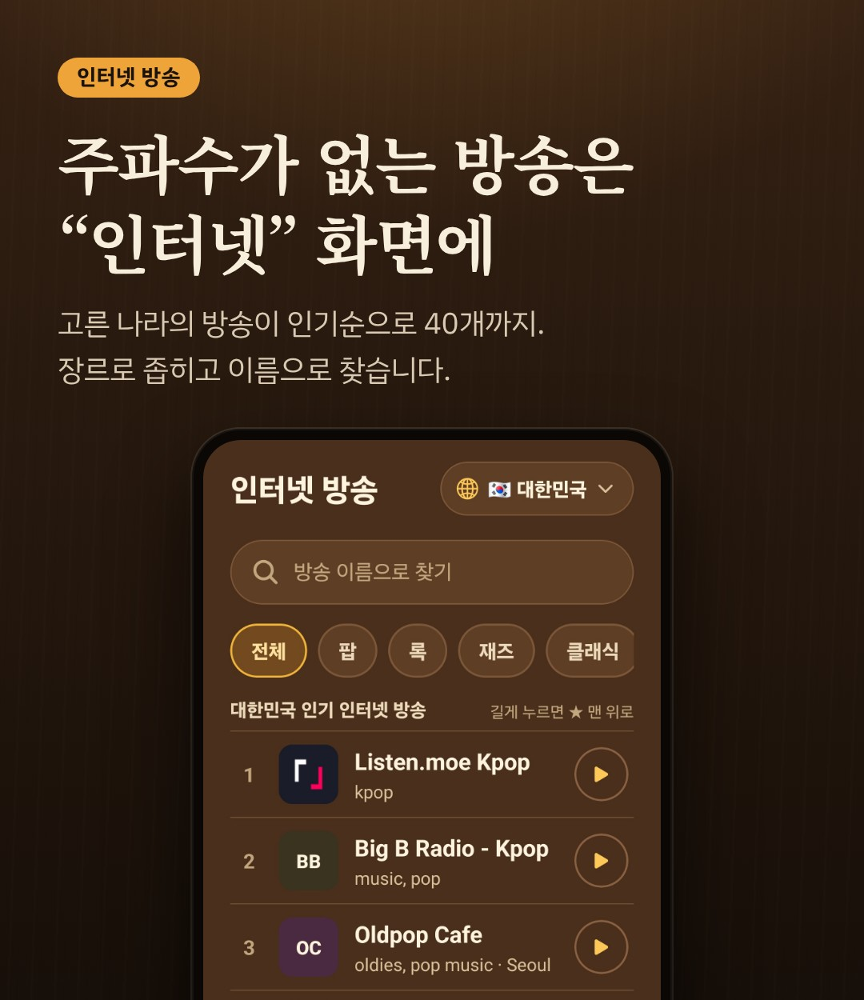
      주파수가 없는 인터넷 전용 방송은 메뉴의 <b>인터넷</b> 화면에 따로 있습니다. 고른 나라의 방송이 인기순으로 40개까지 나오고, 장르로 좁히거나 이름으로 찾습니다.
    </td>
    <td width="50%" valign="top">
      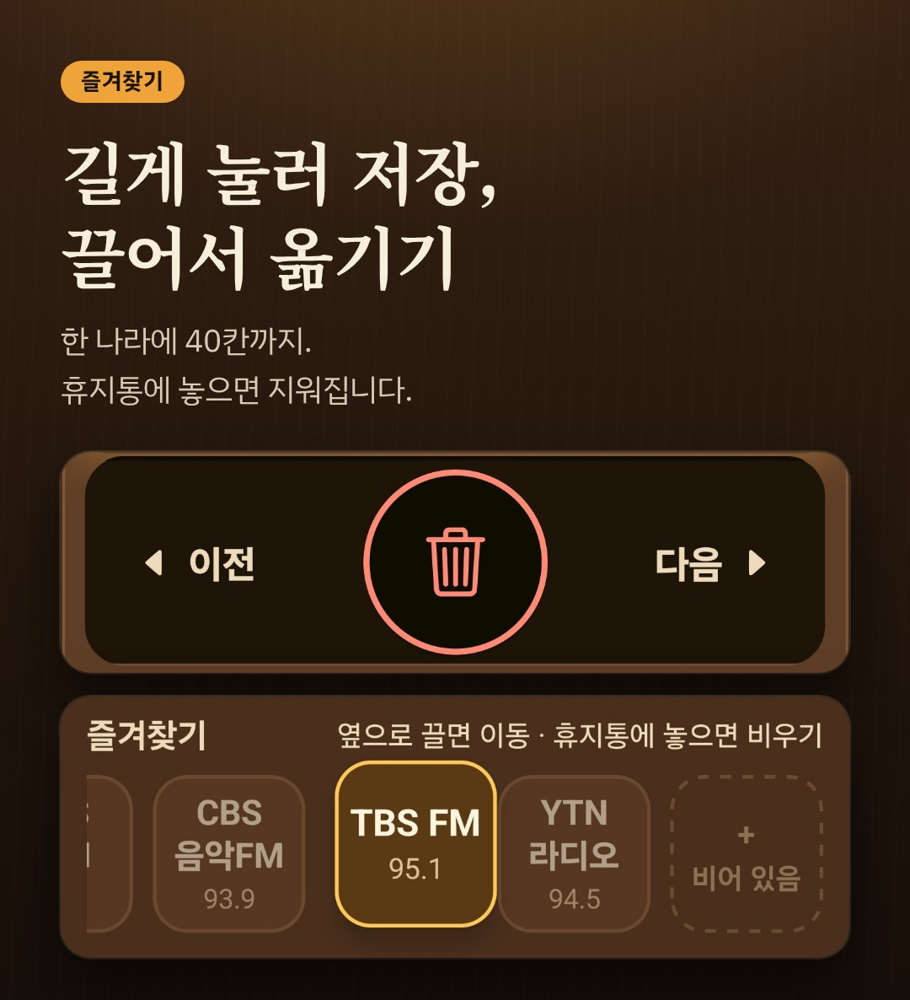
      방송을 듣는 중에 빈칸을 길게 누르면 저장됩니다. 채운 칸을 들어서 옆으로 끌면 순서가 바뀌고, 노브 자리에 나타나는 휴지통에 놓으면 지워집니다. 나라마다 따로, 40칸까지 둡니다.
    </td>
  </tr>
  <tr>
    <td width="50%" valign="top">
      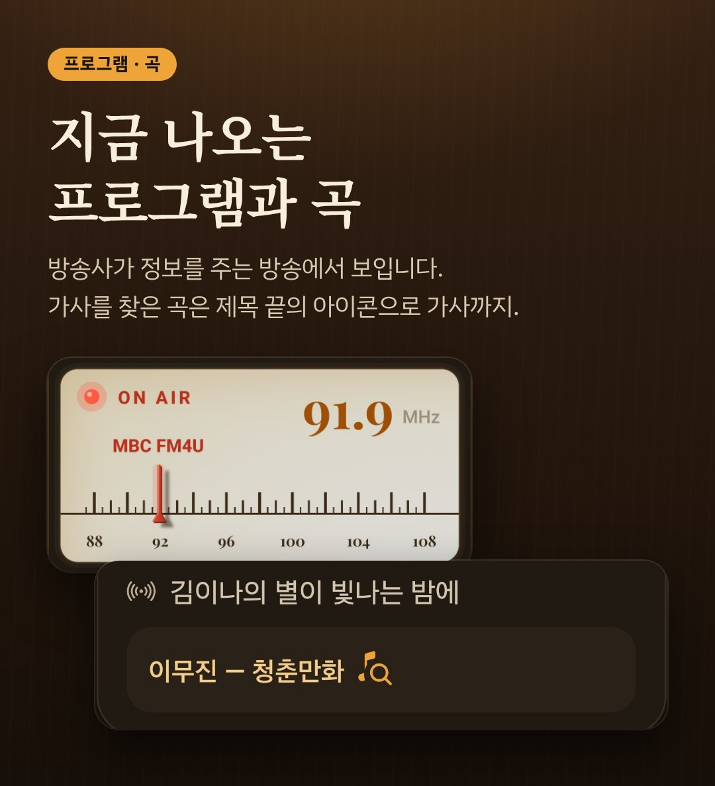
      프로그램 이름은 KBS · MBC · SBS · CBS · EBS · 국악방송에서, 곡은 MBC와 SBS에서 방송사가 알려 주는 정보로 보입니다. 가사를 찾은 곡은 제목 끝의 아이콘을 눌러 전체 가사를 봅니다. 노래에 맞춰 움직이는 가사는 아닙니다.
    </td>
    <td width="50%" valign="top">
      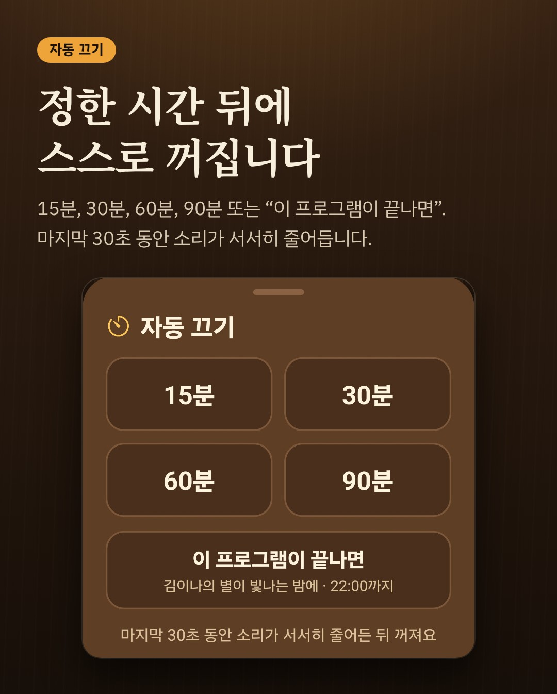
      <b>자동 끄기</b> — 15분, 30분, 60분, 90분, 또는 "이 프로그램이 끝나면"(끝나는 시각을 아는 방송에서). 마지막 30초 동안 소리가 서서히 줄어든 뒤 꺼집니다.
    </td>
  </tr>
  <tr>
    <td width="50%" valign="top">
      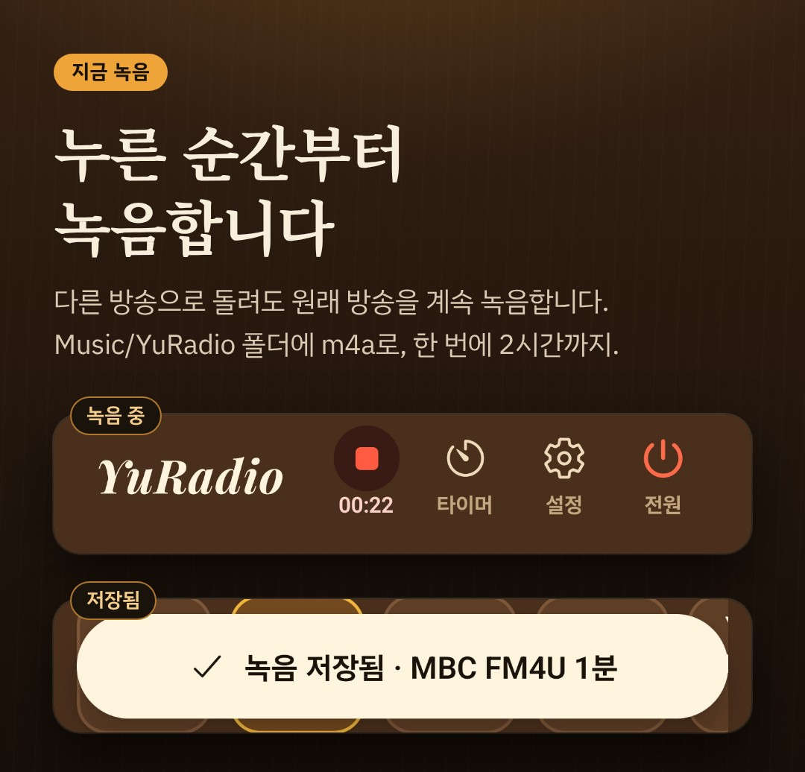
      <b>지금 녹음</b> — 빨간 동그라미를 누른 순간부터 녹음합니다. 다른 방송으로 돌려도 원래 방송을 계속 녹음하고, 휴대폰의 Music/YuRadio 폴더에 m4a로 저장합니다. 한 번에 2시간까지입니다.
    </td>
    <td width="50%" valign="top">
      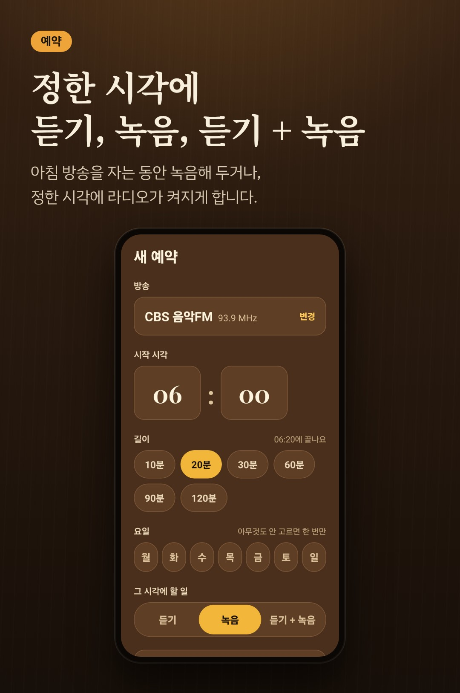
      <b>예약</b> — 시각, 길이, 요일을 정하고 "듣기", "녹음", "듣기 + 녹음" 가운데서 고릅니다. 아침 6시 방송을 자는 동안 녹음해 두거나, 정한 시각에 라디오가 켜지게 할 때 씁니다.
    </td>
  </tr>
  <tr>
    <td width="50%" valign="top">
      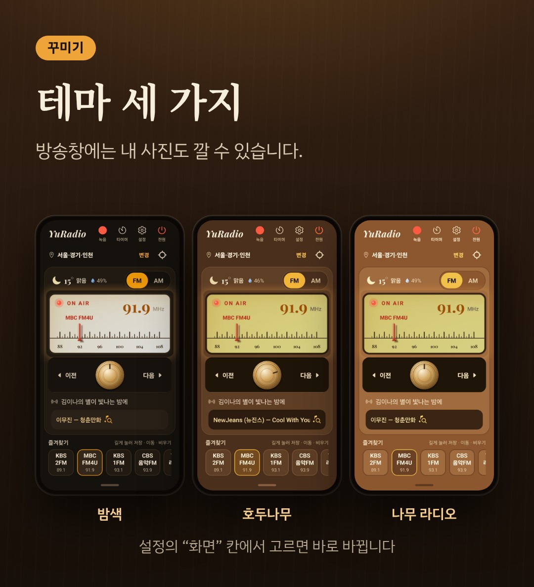
      테마는 밤색 · 호두나무 · 나무 라디오 세 가지입니다. 방송창에 내 사진을 깔 수 있고, 음색은 원음 · 진공관 · AM 라디오 가운데서 고릅니다.
    </td>
    <td width="50%" valign="top">
      <b>그 밖에</b>
      <ul>
        <li>녹음한 방송은 메뉴의 <b>재생</b> 화면에서 듣고, 이름을 바꾸고, 카테고리로 나눕니다</li>
        <li><b>청취 모드</b>를 "Wi-Fi에서만"으로 두면 모바일 데이터로는 방송을 틀지 않습니다</li>
        <li>설정의 <b>정보</b> 칸에서 오늘 · 이번 달 데이터 사용량을 봅니다</li>
        <li>처음 켤 때 한국어와 English 가운데서 고릅니다</li>
      </ul>
    </td>
  </tr>
</table>

### 다이얼이 있는 지역

지역마다 어떤 방송이 어느 주파수에 있는지 적은 방송표가 들어 있는 곳은 8개 나라 28개 지역입니다. 방송표가 아직 없는 나라 14곳은 다이얼이 비어 있고, 그 나라 방송은 인터넷 화면에서 듣습니다.

| 나라 | 지역 |
|---|---|
| 대한민국 | 서울·경기·인천 (FM 27개, AM 5개) |
| 미국 | 뉴욕, 로스앤젤레스, 시카고 |
| 중국 | 베이징, 상하이, 광저우, 청두 |
| 독일 | 베를린, 함부르크, 뮌헨, 쾰른, 프랑크푸르트, 슈투트가르트 |
| 일본 | 도쿄, 오사카, 나고야, 후쿠오카, 삿포로 |
| 영국 | 런던, 버밍엄, 맨체스터, 글래스고, 에든버러 |
| 프랑스 | 파리, 리옹, 마르세유 |
| 아일랜드 | 더블린 |

---

## GitHub에서 바로 실행할 수 있나요?

**앱 그대로는 아니지만, 화면은 바로 만져 볼 수 있어요.**

- **웹 시뮬레이션** — [웹에서 바로 만져 보기](https://nexteco.github.io/homepage/yuradio/demo/)를 누르면 브라우저에서 노브를 돌려 방송을 찾고, FM · AM, 전원, 테마를 바꿔 볼 수 있습니다. 앱 화면을 그대로 본떠 만든 웹 페이지이고, GitHub Pages가 띄워 줍니다. **방송 소리는 나오지 않습니다.** 서울·경기·인천의 방송 위치는 앱과 같습니다.
- **실제 앱** — 방송을 들으려면 안드로이드 휴대폰에 설치해야 합니다. 아이폰판은 없습니다. 방법은 바로 아래 [설치 방법](#설치-방법)에 있습니다.

이 홈페이지에는 소개 글, 실제 화면, 웹 시뮬레이션, 사용자 매뉴얼을 두었습니다. 앱의 소스 코드는 공개하지 않습니다.

---

## 설치 방법

한번 사용해 보고 싶으신 분은 아래 단계를 따라 주세요. 아직 정식 출시 전이라 Play 스토어에서 검색해도 나오지 않지만, 다음 단계를 거치면 사용해 볼 수 있어요.

**필요한 것:** 안드로이드 휴대폰, 구글 계정

**1. 구글 그룹에 가입합니다.** 
https://groups.google.com/g/yuradio-testers

휴대폰의 Play 스토어에 로그인된 구글 계정과 **같은 계정**으로 가입합니다. 출시 전에는 이 그룹에 가입한 계정에만 앱이 열립니다. 가입한 계정의 이메일 주소는 그룹 관리자(만든 사람)에게 보입니다.

**2. 아래 페이지를 열어 참여 버튼을 누릅니다.** 
https://play.google.com/apps/testing/kr.nexteco.yuradio

**3. 그 페이지에 있는 Play 스토어 링크로 설치합니다.**

### 처음 켜면

- 한국어와 English 가운데 언어를 고르는 화면이 먼저 나옵니다.
- 조금 뒤 대략적인 위치를 한 번 묻습니다. 허용하지 않아도 라디오는 그대로 들립니다. 그때는 고른 지역의 날씨가 보이고, 지역은 **변경**에서 직접 고릅니다.
- 라디오는 오른쪽 위 **전원**으로 켜고 끕니다. 소리 크기는 휴대폰의 음량 버튼으로 맞춥니다.
- 예약을 쓰려면 휴대폰 설정에서 YuRadio의 **알람 및 리마인더**를 허용합니다(안드로이드 12 이상). 예약을 저장하면 앱이 안내하고, **설정 열기**를 누르면 그 화면으로 갑니다.

자세한 사용법은 **[사용자 매뉴얼 v2 (PDF, 35쪽)](docs/YuRadio-user-manual-v2-ko.pdf)** 에 있습니다.

### 막힐 때

- **2번 페이지가 열리지 않거나 참여할 수 없다고 나오면** 계정이 서로 다른 경우가 가장 많습니다. 휴대폰에 구글 계정이 여러 개라면 세 곳이 같은 계정인지 확인해 주세요. 그룹에 가입한 계정, 2번 페이지를 연 브라우저의 계정, Play 스토어의 계정입니다.
- **Play 스토어에서 "YuRadio"를 검색해도 나오지 않습니다.** 출시 전이라 그렇습니다. 꼭 2번의 주소로 들어가 주세요.
- **아이폰에서는 쓸 수 없습니다.** 안드로이드 전용 앱입니다.

### 써 보시고 알려 주세요

끊기는 방송, 잘리는 화면처럼 이상한 점이 있으면 [Issues](https://github.com/nexteco/homepage/issues)나 이메일(nexteco.kr@gmail.com)로 알려 주세요. 휴대폰 기종과, 설정의 **정보** 칸에 있는 **버전**을 함께 적어 주시면 원인을 찾기가 쉽습니다.

---

## 데이터와 권한

- 회원 가입이 없습니다. 앱 안에 광고가 없습니다. 방송사가 내보내는 광고는 방송 그대로 나옵니다. 앱을 만든 쪽은 사용 기록을 모으지 않습니다.
- 휴대폰이 묻는 권한은 **대략적인 위치**(날씨와 지역 찾기)와 **알림**(녹음 · 예약 알림) 두 가지입니다. 둘 다 허용하지 않아도 라디오는 들립니다. 마이크는 쓰지 않습니다.
- 방송, 프로그램 · 곡 정보, 날씨, 가사, 인터넷 방송 목록은 각 서비스의 서버에서 받아 오므로 그쪽으로 요청이 나갑니다. 예를 들어 날씨를 받을 때는 약 1km 단위로 뭉갠 내 위치나 고른 지역 대표 도시의 좌표가 노르웨이 기상청(MET Norway)으로 갑니다. 무엇이 어디로 가는지는 매뉴얼 15장의 표에 있습니다.
- 모바일 데이터로 들으면 데이터가 듭니다. 걱정되면 설정의 **청취 모드**를 "Wi-Fi에서만"으로 둡니다.
- [개인정보처리방침](https://nexteco.github.io/yuradio-legal/)

---

## 아직 안 되는 것

지금 알고 있는 것입니다.

- 대한민국은 아직 서울·경기·인천 방송만 다이얼에 있습니다. 다른 지역을 골라도 수도권 방송이 나옵니다.
- 일본 다이얼의 방송은 대부분 NHK인데, NHK는 일본 안에서만 들을 수 있습니다.
- 예약을 정한 시각에 정확히 실행하려면 **알람 및 리마인더**를 허용해야 합니다. 허용하지 않으면 늦게 실행되거나, 앱이 화면에 없을 때는 실행되지 않을 수 있습니다.
- 길이가 120분인 녹음 예약은 정한 끝 시각보다 1분쯤 일찍 끝납니다. 한 번 녹음이 2시간까지이기 때문입니다.
- 나라와 지역을 고르는 창의 아래쪽이 휴대폰 아래쪽 버튼 줄과 겹쳐 보일 수 있습니다(갤럭시 S22 울트라에서 확인).
- 방송사 사정으로 연결되지 않는 방송이 섞여 있을 수 있습니다. 프로그램 · 곡 정보는 방송사 웹에서 받아 오므로, 방송사가 웹을 바꾸면 한동안 보이지 않을 수 있습니다.
- 아이폰용은 없습니다.

---

## 만든 이야기

혼자 만든 사이드 프로젝트입니다. 2026년 4월에 시작했고, 9월 30일부터 2.0으로 다시 짰습니다. 무엇을 만들지, 화면이 어떻게 보여야 하는지 정하고 실제 휴대폰에서 시험하는 일은 제가 했고, 코드는 AI(Claude Code)와 함께 짰습니다.

<b>기술 스택과 구조</b>

 

| 항목 | 내용 |
|---|---|
| **스택** | React Native 0.81 · Expo SDK 54 · TypeScript · Zustand · SQLite · react-native-track-player |
| **네이티브** | 직접 만든 Expo 모듈 `StreamTapper` (Kotlin + C++) — 방송 소리 가로채기 · Chromaprint 음향 지문 · 백그라운드 하트비트 · 튜닝 잡음 · 음색 · 예약 알람 |
| **규모** | TypeScript 약 2만 6천 줄, Kotlin 약 2,800줄, 순수 로직 유닛 테스트 14묶음 |
| **곡 정보** | ① 방송사 웹 API(6곳) → ② 스트림에 실린 메타데이터(ICY / ID3) → ③ 사용자가 켰을 때만 AcoustID 음향 지문 |
| **가사** | LRCLIB에서 미리 찾아 SQLite에 저장, 찾은 곡에만 아이콘 |

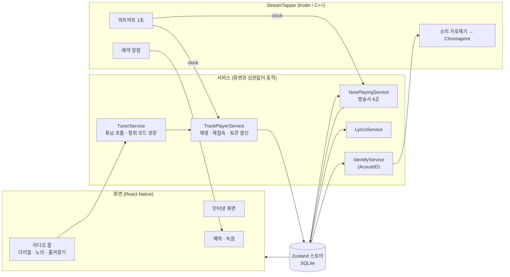

- **화면은 스토어를 읽기만 합니다.** 곡 정보 · 가사 · 식별은 React 훅이 아니라 모듈 하나로 도는 서비스입니다. 스토어를 구독하고 자체 시계(`clock`)로 일정을 잡기 때문에, 어느 화면이 떠 있든, 화면이 꺼져 있든 같은 방식으로 동작합니다.
- **순수 로직은 따로 둡니다.** 다이얼 방송표, 다음 방송, 화면 높이 맞추기, 예약 회차, 즐겨찾기 옮기기 계산은 React Native 없이 도는 함수이고, `node:test`로 시험합니다.
- **소리는 반드시 튜너를 거쳐 켭니다.** 그래야 바늘 · 표시등 · 이어 듣기 · 청취 모드가 어긋나지 않습니다.

<b>만들면서 풀어 낸 문제 7가지</b>

 

시간이 가장 많이 든 것은 기능보다 "왜 실제 휴대폰에서만 이상하지?"였습니다.

**1. 제목이 소리보다 먼저 바뀐다**
- 원인: 방송사 API는 "방송 시각" 기준인데, 앱은 실시간보다 보통 20~40초 늦게 재생합니다.
- 해결: 곡과 프로그램을 고르는 기준을 "지금 들리는 시각"(`지금 − 스트림 지연`)으로 바꿨습니다. 지연은 재생 엔진(ExoPlayer)의 실제 라이브 오프셋을 읽고, 읽을 수 없으면 HLS 윈도우로 추정합니다. 추정치가 세그먼트마다 톱니처럼 흔들려서 최근 30초의 최댓값을 씁니다.

**2. MBC 곡 정보는 "등록 시각"이다**
- 실측: 스트림 소리와 API 응답을 나란히 놓고 재 보니, 곡 등록이 실제 시작보다 20초~2분 늦었고, 곡이 끝나도 5분 동안 남았습니다.
- 해결: 등록 시각을 30초 앞당겨 시작으로 보고, 곡 길이만큼만 보여 줍니다(가사를 찾았으면 그 곡 길이, 아니면 210초).
- 포기한 것: 노래방처럼 움직이는 가사 싱크는 이 오차를 맞출 방법이 없어 뺐습니다.

**3. 화면을 끄면 재접속이 멈춘다**
- 원인: React Native의 타이머는 화면 그리기에 묶여 있어 백그라운드에서 멈춥니다. 실측해 보니 같은 15초 동안 화면이 켜져 있을 때 3번 돌던 감시가 꺼져 있을 때는 0번이었습니다.
- 해결: 네이티브 스레드가 1초마다 신호를 보내고, 앱의 시계가 그 신호에 맞춰 밀린 일을 처리합니다. 재접속 · 토큰 갱신 · 곡 정보 확인이 모두 이 시계를 씁니다.

**4. 캐시 설정 한 줄이 KBS를 6분 동안 끊었다**
- 원인: 재생 엔진의 디스크 캐시를 켜 두었더니, 압축되어 내려오는 KBS의 라이브 재생 목록이 캐시에 남아 낡은 판이 계속 돌아왔습니다. 6분 동안 에러가 10번 났습니다.
- 해결: 캐시를 끄자 바로 0번이 되었습니다. 같은 설정에서 MBC는 멀쩡해서 원인을 찾는 데 오래 걸렸습니다.

**5. 다이얼을 빨리 돌리면 앞 방송이 나온다**
- 원인: 방송 주소를 받는 데 최대 12초가 걸려서, 늦게 끝난 앞 방송의 준비가 새 방송 이름 아래에서 재생을 시작했습니다.
- 해결: 방송을 준비할 때마다 번호를 올리고, 단계마다 번호를 다시 확인해 밀린 준비는 버립니다.

**6. "Wi-Fi에서만"인데 모바일 데이터로 들린다**
- 원인: 소리를 켜는 길이 전원 · 다이얼 · 즐겨찾기 · 알림창 · 이어폰 · 재접속 · 예약까지 열 군데가 넘었습니다.
- 해결: 모든 길이 같은 관문을 지나게 하고, 재생 직전에 한 번 더 확인합니다. 듣는 중에 Wi-Fi가 끊기면 몇 초 뒤 멈추고, 1분 안에 돌아오면 다시 켜고, 지나면 끕니다. 몇 시간 뒤 혼자 켜지는 일이 없게 시간 제한을 두었습니다.

**7. 휴대폰마다 화면이 넘치거나 비었다**
- 증상: 한 기종에 맞추면 다른 휴대폰에서 즐겨찾기가 잘리거나 아래가 비었습니다.
- 해결: 기종 이름을 보지 않고 실제로 잰 높이로 맞춥니다. 모자라면 방송창 → 여백 · 노브 · 곡 줄 · 즐겨찾기 순으로 줄이고, 남으면 키웁니다.

<b>테스트와 검증, 개발 방식</b>

 

- **유닛 테스트 14묶음** — 방송사 응답 해석(실제 응답을 그대로 씀), 가사 고르기 점수, 예약의 다음 회차(자정 · 주 1회 포함), 화면 높이 맞추기(높이 400~1400을 하나씩 올려 가며), 즐겨찾기 옮기기, 테마의 글자 대비(4.5:1 이상), 번역 누락과 용어 통일, 다이얼 방송표를 시험합니다.
- **실제 휴대폰에서 찍고 → 고치고 → 다시 찍기** — 갤럭시 S22 울트라(화면을 크게 보는 설정)에서 매뉴얼용 화면을 찍으며 문제를 찾고, 같은 휴대폰에서 다시 찍어 확인했습니다. Z 플립7에서는 화면 높이를 재서 맞췄습니다.
- **기록을 코드 저장소에 남깁니다** — 지킬 규칙과 함정, 결정한 이유는 `CLAUDE.md`에, 날짜별로 무엇을 왜 바꾸고 어떻게 확인했는지는 `WORKLOG.md`에 적습니다. 실제 휴대폰에서 아직 확인하지 못한 것은 그렇다고 적어 둡니다.
- **시안을 먼저 보고 고릅니다** — 다이얼 화면, 헤더 버튼의 글자, 작은 창 화면은 시안을 보고 고른 뒤에 만들었습니다.

---

## 문의 · 링크

- 이상한 점, 궁금한 점 — 이 홈페이지의 [Issues](https://github.com/nexteco/homepage/issues) 또는 이메일 nexteco.kr@gmail.com
- 사용자 매뉴얼 — [YuRadio 사용자 매뉴얼 v2 (PDF)](docs/YuRadio-user-manual-v2-ko.pdf)
- 블로그 — [YuRadio 2.0 소개](https://farmint.tistory.com/14) · [출시 전 설치 방법 3단계](https://farmint.tistory.com/15)
- [개인정보처리방침](https://nexteco.github.io/yuradio-legal/)

**만든 사람** — 박성호 (디지털목수 · NEXTECO)

---

<a href="https://github.com/nexteco/homepage">← 홈페이지로</a>

